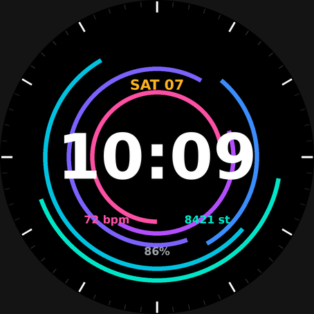

# Aurora Rings – custom Garmin watch face

A Connect IQ watch face with a wallpaper drawn entirely in code (concentric
gradient-coloured arcs on pure black), so it is sharp on any round screen and
AMOLED-friendly. Shows time, date, heart rate, steps and battery.

> `preview.png` is a mock-up rendered with Python, not a screenshot from the
> Garmin simulator. Fonts on the real watch will look slightly different.

## Status
**Not yet compiled.** The Connect IQ SDK needs a Garmin login to fetch device
definitions, so this was written but not built or run on a simulator. Expect
to fix small compile errors on the first build.

## Build and install
1. Install the Connect IQ SDK via the [SDK Manager](https://developer.garmin.com/connect-iq/sdk/)
   and download the device for your watch.
2. Install VS Code + the **Monkey C** extension.
3. Run **Monkey C: Generate a Developer Key** once.
4. Open this folder. Run **Monkey C: Edit Products** and tick *only your watch*
   (the manifest lists many round devices; unused ones can be removed).
5. **Monkey C: Build for Device** → produces `bin/*.prg`.
6. Plug the watch in by USB and copy the `.prg` into `GARMIN/APPS/` on the watch.
7. On the watch: hold the face → pick **Aurora Rings**.

## Customising the wallpaper
Everything is in `source/WallpaperFaceView.mc`:
- `RING_COLORS` – ring colours (0xRRGGBB)
- `starts` / `sweeps` in `drawRings` – where each arc begins and how long it is
- `drawTicks` – bezel tick marks
